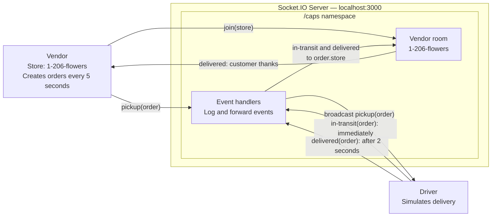

# CAPS — Code Academy Parcel Service

CAPS simulates package pickup and delivery through a vendor, driver, and central event hub.

Lab 11 used a shared EventEmitter inside one Node.js program. Lab 12 uses Socket.IO so the server, vendor, and driver can run as three separate programs.

## Lab 11: EventEmitter — Historical Reference

CAPS is a simulated package delivery tracking system built using Node.js and EventEmitter.

The application uses events to communicate between a vendor, driver, and central CAPS event hub.

The following Lab 11 documentation and UML describe the original implementation. `caps.js` and `index.js` are preserved for reference. The vendor and driver now use Socket.IO, so `node index.js` is no longer the Lab 12 startup command.

## UML Diagram


## Technologies

- JavaScript
- Node.js
- EventEmitter
- Jest

## Application Structure

| File | Purpose |
|---|---|
| `caps.js` | Shared EventEmitter instance |
| `vendor.js` | Creates orders and listens for delivery confirmations |
| `driver.js` | Handles pickups and simulates deliveries |
| `index.js` | Starts the application and logs events |
| `__tests__/caps.test.js` | Jest tests |

## Event Workflow

1. Vendor creates an order.
2. Vendor emits `pickup`.
3. Driver receives the pickup event.
4. Driver emits `in-transit`.
5. Driver simulates delivery after two seconds.
6. Driver emits `delivered`.
7. Vendor receives confirmation and thanks the customer.

A new order is generated every five seconds.

## Installation

```bash
npm install
```

## Lab 11 Startup — Historical Reference

```bash
node index.js
```

Press `Ctrl + C` to stop the simulation.

## Lab 11 Testing — Historical Reference

```bash
npm test -- --runInBand
```

The Jest tests verify that:

- Vendor orders contain the required fields.
- Pickup events are emitted.
- Driver in-transit and delivered events are emitted.

The original Lab 11 documentation recorded four passing tests. The current tests cover the Lab 12 Socket.IO implementation described below.

## Lab 12: Socket.IO

### Component Diagram



The vendor, server, and driver run as three separate Node.js programs. Pickup broadcasts reach all other clients in `/caps`; the driver handles them. The server sends both `in-transit` and `delivered` events to the room matching `order.store`, but the current vendor listens only for `delivered` and thanks the customer.

### Application Structure

| File | Purpose |
|---|---|
| `socket-server.js` | Starts the Socket.IO server and forwards events |
| `vendor.js` | Creates orders and receives delivery confirmations |
| `driver.js` | Handles pickups and simulates delivery |
| `__tests__/caps.test.js` | Tests event handlers with mocked Socket.IO |
| `caps.js` | Preserved Lab 11 EventEmitter |
| `index.js` | Preserved Lab 11 entry point |

### Namespace and Vendor Rooms

The server listens on port 3000. Both clients connect to `http://localhost:3000/caps` using `socket.io-client`. `/caps` is the shared namespace for CAPS communication.

The vendor emits `join` with its store name, `1-206-flowers`. The server adds that connection to a room with the same name. Status updates are sent to the room matching `order.store`.

### Run Lab 12

After installing dependencies with `npm install`, open three terminals in the CAPS project directory. Run these commands in order:

| Terminal | Command |
|---|---|
| 1 — Server | `node socket-server.js` |
| 2 — Driver | `node driver.js` |
| 3 — Vendor | `node vendor.js` |

Start the driver before the vendor so it is listening for pickups. The vendor creates its first order five seconds after connecting, then creates another every five seconds.

Press `Ctrl+C` in each terminal to stop its program. Use these three commands for Lab 12 rather than `node index.js`.

### Event Flow

1. Vendor connects to `/caps` and joins its store room.
2. Vendor creates an order and emits `pickup`.
3. Server logs the event and broadcasts it to other clients in `/caps`.
4. Driver receives the pickup, logs confirmation, and immediately emits `in-transit`.
5. Server logs `in-transit` and forwards it to the order's store room.
6. After two seconds, the driver logs delivery and emits `delivered`.
7. Server logs `delivered` and forwards it to the order's store room.
8. Vendor receives confirmation and thanks the customer.

Orders retain the `store`, `orderId`, `customer`, and `address` fields. The vendor currently handles delivery confirmations; it does not register an `in-transit` listener.

### Testing

Run:

```bash
npm test -- --runInBand
```

Current result: **9 Jest tests passing**, as reported by the project author after running the suite.

The tests cover:

- Vendor order fields, logging, and pickup emission.
- Store-room joining, five-second scheduling, and duplicate-timer prevention.
- Customer thanks and filtering of another store's delivery.
- Driver logging, immediate in-transit emission, and two-second delivery.
- Server connection handling and room joining.
- Server pickup logging and broadcasting.
- Server in-transit and delivered logging and store-room forwarding.

Socket.IO is mocked to avoid real network connections. Console spies verify logging, and fake timers verify scheduled behavior. These are unit tests for event handlers; they do not exercise communication between three running programs.

### Manual Verification

The project author also reported a successful manual test with the Socket.IO server, vendor, and driver running as three separate applications. This complements the mocked unit tests by checking communication between the running programs. The assistant did not independently observe this manual test.

## AI Assistance Disclosure

ChatGPT/Codex assisted with Lab 11 and Lab 12.

**Lab 11 prompts (representative excerpts retained from the original documentation):**

- "Continue Lab 11 manually in VS Code and terminal, one step at a time."
- "can you please say unbuntu bash or vs code terminal to differientiate where i should input"
- "my instructor gave me the fork to utilize so please try to hurry this along"

**Lab 11 AI contributions:**

- Suggested the EventEmitter-based application structure.
- Generated initial vendor, driver, and application entry-point code.
- Generated Jest tests using spies and fake timers.
- Helped troubleshoot npm installation, JSON syntax, and asynchronous Jest warnings.
- Assisted with README documentation.

**Lab 12 AI contributions:**

- Reviewed the server, vendor, driver, tests, and README.
- Proposed and applied approved Socket.IO changes to `vendor.js` and `driver.js`.
- Added the approved vendor order schedule and explanatory comments.
- Replaced EventEmitter tests with nine mocked Socket.IO unit tests.
- Attempted a test run and inspected Node/npm paths after an environment error prevented Jest from starting.
- Proposed and applied approved README documentation updates.

The project author subsequently reported that all nine tests passed and that manual testing of the three running applications succeeded. The assistant did not independently verify those successful runs.

**Representative Lab 12 prompts, quoted from the conversation:**

- "Please perform a **read-only review** of this project."
- "Please prepare Step 1 of Lab 12: converting vendor.js to use Socket.IO."
- "Please prepare Step 2 of CAPS Lab 12: converting driver.js from EventEmitter to Socket.IO."
- "Approved. Implement the proposed nine Jest test cases."

Changes were proposed for review and applied after approval.
